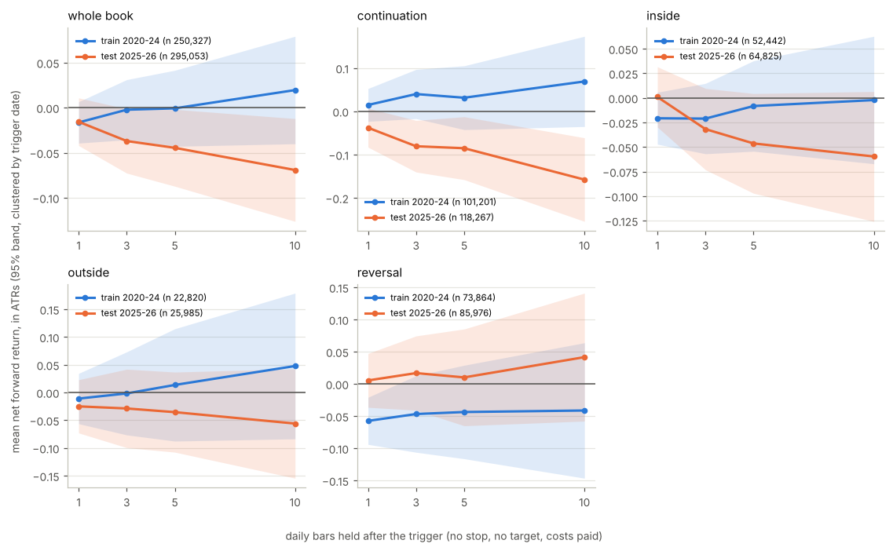

# STRAT Trigger Research v3

Binance USDT-M perps, daily triggers, 2020-01-03 to 2026-10-06; 554,939 trigger rows with a 10-bar outcome on 898 coins after the stablecoin drop. Built 2026-10-22. Spec: docs/experiments/strat_ml_phase3_brief.md. Phase 1 is cited, not re-run.

**Gate: FAILED. No family clears net 5-bar forward return > 0 with clustered z >= 2 on the test period (2025-26) after costs: continuation -0.085 ATR (-0.78% of price, -0.081R), z -2.3, n 118,267; inside -0.046 ATR (-0.39% of price, +0.003R), z -1.8, n 64,825; outside -0.035 ATR (-0.35% of price, -0.000R), z -1.0, n 25,985; reversal +0.010 ATR (+0.02% of price, +0.069R), z +0.3, n 85,976.**

**Summary.** Each table's verdict, verbatim, in page order:

- *0a. Headline numbers: as published, corrected, and after costs*: Verdict: contradicts -- dropping the stablecoin perps changes phase 1's headline materially, because the whole-book mean R moves by +0.0004 (+0.04 dollars per $100 risked) on 554,939 rows.
- *0b. The stablecoin perps dropped (logged to analysis/strat_ml/stablecoins_dropped.json)*: Verdict: supports -- the universe held stablecoin perps that drag the book, because 1 symbol(s) matched the rule, worst USDCUSDT at mean R -0.233 on 1,153 rows.
- *0c. Section 3f re-rendered: strongest feature pairs (interactions, model A refit on coded categoricals)*: Verdict: supports -- the BTC-vol regime feature also drives the strongest feature pairs, because the top pair is long or short x BTC 30-day realized volatility vs the last year (0-1) at 0.0195.
- *1a. Parameters*: Verdict: supports -- costs are on the order of half the phase-1 loss, because the mean cost is +0.176% of price per trade against a mean managed result of -0.331% of price (53% of the loss).
- *1b. Cost per trade by liquidity tier and family, phase-1 exits*: Verdict: supports -- any cell that reads positive before fees is at or under zero after them, because 2 of 12 cells (300+ rows) were positive before costs and 0 stay positive after; the mean cost is +0.029R per trade.
- *2a. Which 0.25R move came first: hourly clock vs 15-minute clock, same rows*: Verdict: supports -- the hourly 'against first' majority is an artefact of the trigger hour's own range, because against-first is 67.8% on the hourly clock and 55.7% on 15-minute bars with the trigger bar counted (47.5% ignoring the trigger bar's own adverse print; phase 1 estimated 27%).
- *3a. By family and horizon (the headline table)*: Verdict: inconclusive -- after a daily STRAT trigger price keeps going the break's way on average over 5 bars, net of costs (whole sample, by family), because every cell is inside its own noise, e.g. inside -0.029 ATR, z -1.7, n 117,267.
- *3b. By pattern and direction, 10-bar hold*: Verdict: contradicts -- after a daily STRAT trigger price keeps going the break's way on average over 10 bars, net of costs (by pattern and direction), because 1-1-2 stacked inside long -0.165 ATR, z -2.3, n 6,494 (the other 19 cells with 300+ rows are inside their own noise).
- *3c. By BTC 30-day realized-vol tercile and family, 5-bar hold*: Verdict: contradicts -- after a daily STRAT trigger price keeps going the break's way on average over 5 bars, net of costs in some BTC-volatility regime, because high vol continuation -0.101 ATR, z -2.3, n 60,925 (the other 11 cells with 300+ rows are inside their own noise).
- *3d. By year and family, 5-bar hold*: Verdict: contradicts -- after a daily STRAT trigger price keeps going the break's way on average over 5 bars, net of costs consistently across years, because 2022 inside -0.099 ATR, z -2.1, n 8,814; 2026 inside -0.064 ATR, z -2.2, n 33,940 (the other 26 cells with 300+ rows are inside their own noise).
- *3e. By liquidity tier, 5-bar hold*: Verdict: inconclusive -- after a daily STRAT trigger price keeps going the break's way on average over 5 bars, net of costs in some liquidity tier, because every cell is inside its own noise, e.g. tier 3 -0.031 ATR, z -1.9, n 441,132.
- *3f. Train vs test: by family and horizon (the gate table)*: Verdict: contradicts -- after a daily STRAT trigger price keeps going the break's way on average over 5 bars, net of costs on the unseen 2025-26 period (the gate), because continuation 5-bar -0.085 ATR, z -2.3, n 118,267 (inconclusive for inside 5-bar, outside 5-bar, reversal 5-bar).
- *3g. Train vs test: by BTC-vol tercile and family, 5-bar hold*: Verdict: inconclusive -- after a daily STRAT trigger price keeps going the break's way on average over 5 bars, net of costs in some BTC-volatility regime, on both train and test, because every cell is inside its own noise, e.g. high vol continuation -0.110 ATR, z -1.7, n 28,049.

Next phase: the alt-coin line stops here; the HIP-3 session branch (brief section 11: test 1 on the session build clustered by date, leave-one-ticker-out, the gap rule, the fair-line sweep) is the next run, and the underlying-stock control needs an equity feed this environment does not have.

> **How to read this page.** One row of data is one time a coin broke yesterday's high (long) or low (short) on the daily chart. Phase 1 traded every such break with a stop at the far side of yesterday's bar and a STRAT target, and found the book flat before fees. This page asks the question underneath that result: if you took every break and simply held, costs paid, does price keep going your way at all? Every R number here is after fees, slippage and funding, and every table says in plain words what one row is, what to look at, and what it decided. Size every trade so the stop costs $100 and every R reads as dollars per $100 risked. Grey rows have fewer than 300 samples and are never quoted in a verdict.

## Glossary in trader terms

Every term below must be used with this meaning in the report, and the report's own glossary block (top of the page) reproduces these definitions verbatim. The running convention: **size every trade so the stop costs $100.** Then every number in R reads as dollars per $100 risked.

| term | what it means | example |
| --- | --- | --- |
| R | Your risk per trade, in dollars. 1R = what the stop costs. | Stop costs $100, so 1R = $100. |
| +0.5R | The trade is up half your risk. | Up $50 on a $100 risk. "Move stop to breakeven at +0.5R" = once up $50, stop goes to entry so the trade can't lose. |
| −1R | Stopped out. | Lost $100. |
| Mean R | Average result per trade. What the account does over many trades. | Mean R −0.032 = lost $3.20 per $100 risked, on average, before fees. |
| Median R | The middle trade. What a typical trade feels like. | Median +0.056 = typical trade made $5.60. Mean −0.032 at the same time = losers big enough to drag the average under zero. |
| Target at 0.4R | Aiming to make 40% of what you're risking. | Make $40, risk $100. |
| Reward-to-risk (R:R) | Target distance divided by stop distance. | T1 0.4R away, stop 1R away: R:R 0.4. |
| Fair hit rate | The win rate a coin-flip market gives for that stop and target. Nearer target = hit more often, with no edge involved. Formula: 1 ÷ (1 + R:R). | R:R 0.4 → fair = 71%. You need to hit the target more than 71 times in 100 to make money. |
| Excess over fair | Observed target-first % minus fair hit rate. The only hit-rate number that isn't geometry. | Reversals: 69% observed vs 71% fair = −2 points. No edge. |
| Target-first % | Share of trades that touched the target before the stop. Not the same as win %. |  |
| Win % | Share of trades that closed above zero after 10 bars, however they got there. |  |
| MFE / MAE | Best and worst the trade got during the window if you had never exited. | Median MFE 1.6R = half the trades were up at least $160 at some point. Median MAE 1.58R = half were also down at least $158 at some point. Exits at +$40 and −$100 sit inside that swing. |
| Drift | Whether price keeps going the break's way, on average, if you just hold. The only thing any exit rule can harvest. | No drift = no stop or target or trail can help; the trade is a coin flip whatever you do with it. |
| Expectancy | Mean R after fees, funding and slippage. The number that decides whether to trade it. |  |
| Walk-forward / train–test | Rules found on 2020–24, judged on 2025–26 which the rules never saw. | A rule that holds on both is real. One that only holds on 2020–24 was fitted to noise: that is what "overfit" means. |
| Decile | Sort trades by a model's score, cut into 10 equal buckets. | Decile 1 = the model's least-favourite 10%. If decile 1 loses and decile 10 wins, the model can rank. |
| ATR | Average true range: the coin's normal daily swing. Used to compare moves across coins that move at different speeds. | Stop at 0.6 ATR = stop set at 60% of a normal day's range. |
| z vs own noise | Mean R divided by how much that cell's results bounce around. Below 2 = could be luck. | A coin with +0.08R and z 1.8 is at the edge of noise. |

## 0. Phase 1, corrected: the three known bugs and what they changed

The brief lists three phase-1 bugs to fix before anything runs: the section 3f interaction table crashed on an unencoded categorical, a stablecoin perp (USDCUSDT) sat in the universe, and the assembled phase-1 page numbered its caveats section 5 after sections 6-10. All three are handled here without touching the phase-1 outputs: this page is numbered in page order with the caveats last, the stablecoin rule below removes every stable perp from the corrected table, and 3f is re-rendered in 0c. The phase-1 report and code stay as published.

### 0a. Headline numbers: as published, corrected, and after costs

**What this means.** One row is one headline number from phase 1. The first column is phase 1 exactly as published (before fees, stablecoins still in); the second is the same calculation after the stablecoin drop; the third is the second with fees, slippage and funding taken out of every trade (mean R after costs: dollars per $100 risked once the exchange has been paid). Look at how little the drop moves the numbers, and how much the costs do.

| metric | phase 1 as published (before fees) | corrected: stablecoins dropped (before fees) | corrected, after costs |
| --- | --- | --- | --- |
| rows | 556,092 | 554,939 |  |
| coins | 899 | 898 |  |
| rows in test (2025-26) | 301,054 | 300,492 |  |
| win % | 53.9% (53.8-54.1) | 54.0% (53.8-54.1) | 52.8% |
| target-first % | 53.0% | 53.0% |  |
| mean R (winsorized) | -0.0315 | -0.0311 | -0.0541 |
| median R | +0.0564 | +0.0567 | +0.0370 |
| median MFE / MAE (R) | 1.60 / 1.60 | 1.60 / 1.60 |  |
| mean ret (% of price) | -0.331% | -0.331% | -0.506% |

*Verdict: contradicts -- dropping the stablecoin perps changes phase 1's headline materially, because the whole-book mean R moves by +0.0004 (+0.04 dollars per $100 risked) on 554,939 rows.*

### 0b. The stablecoin perps dropped (logged to analysis/strat_ml/stablecoins_dropped.json)

**What this means.** One row is one symbol removed from the universe. The rule: the base asset is a stablecoin by name (USDC, BUSD, TUSD, FDUSD, USDP, DAI, USDD), or the hourly close sat within 1% of 1.00 for 90% of the symbol's history. 'Mean R (phase 1)' is what those rows did in the phase-1 book (a stable perp's 'yesterday's high' is noise with a tiny stop, so the setup-bar stop is hit constantly). Look at whether anything besides USDC was caught.

| symbol | reason | share of hours within 1% of 1.00 | rows | mean R (phase 1) | win % |
| --- | --- | --- | --- | --- | --- |
| USDCUSDT | base name + price band | 1.00 | 1,153 | -0.233 | 42.7% |

*Verdict: supports -- the universe held stablecoin perps that drag the book, because 1 symbol(s) matched the rule, worst USDCUSDT at mean R -0.233 on 1,153 rows.*

### 0c. Section 3f re-rendered: strongest feature pairs (interactions, model A refit on coded categoricals)

**What this means.** Phase-1 section 3f, re-rendered. One row is a pair of context features; the number is how much the two move the model's predicted R together, beyond what each does alone (mean absolute SHAP interaction over 1,500 test-period rows). The phase-1 call crashed because the categorical columns were passed as text; here they are integer-coded first and model A is refit on the coded frame, same parameters, same features, same train rows. Look at whether the regime feature (BTC's 30-day realized-vol percentile, the top single feature in phase 1) is in the strongest pairs.

| feature a | feature b | mean abs interaction |
| --- | --- | --- |
| long or short | BTC 30-day realized volatility vs the last year (0-1) | 0.019 |
| BTC 30-day realized volatility vs the last year (0-1) | 0 = Monday .. 6 = Sunday | 0.011 |
| reversal / continuation / inside / outside | BTC 30-day realized volatility vs the last year (0-1) | 0.011 |
| BTC's week green / red | BTC 30-day realized volatility vs the last year (0-1) | 0.008 |
| share of week + month pushing the trade's way (type and colour) | BTC 30-day realized volatility vs the last year (0-1) | 0.007 |
| where the setup bar closed in its range (0 = low, 1 = high) | BTC 30-day realized volatility vs the last year (0-1) | 0.007 |
| BTC's month green / red | BTC 30-day realized volatility vs the last year (0-1) | 0.007 |
| the week so far, as a bar type, at the trigger hour | BTC 30-day realized volatility vs the last year (0-1) | 0.006 |
| long or short | setup bar range in ATRs | 0.006 |
| how volatile the coin is vs its own last year (0-1) | BTC 30-day realized volatility vs the last year (0-1) | 0.006 |

*Verdict: supports -- the BTC-vol regime feature also drives the strongest feature pairs, because the top pair is long or short x BTC 30-day realized volatility vs the last year (0-1) at 0.0195.*

## 1. The cost model: what the exchange takes out of every row

### 1a. Parameters

**What this means.** The parameters, as the brief sets them and as the config block at the top of report_v3.py holds them. Entry is a stop-market at the break, so it pays the taker fee and slippage; a target exit is a resting limit (maker, no slippage); a stop exit, a timeout mark and the hold-N-bars exits of test 1 are taker. Funding is the coin's actual rate at every 8-hour mark the trade is open across, paid by longs when positive and by shorts when negative. The brief's claim to check: costs are on the order of half of phase 1's loss.

| component | Binance USDT-M | HIP-3 (Hyperliquid) |
| --- | --- | --- |
| taker fee, each side | 0.050% | 0.045% |
| maker fee (resting target exit) | 0.020% | 0.015% |
| slippage, tier 1 (top 10), taker legs | 0.020% | 0.050% |
| slippage, tier 2 (11-50) | 0.030% | 0.050% |
| slippage, tier 3 (rest) | 0.050% | 0.050% |
| funding | actual series, per mark the trade is open across, signed | none in the frozen snapshot: charged 0, flagged |

*Verdict: supports -- costs are on the order of half the phase-1 loss, because the mean cost is +0.176% of price per trade against a mean managed result of -0.331% of price (53% of the loss).*

### 1b. Cost per trade by liquidity tier and family, phase-1 exits

**What this means.** One row is every phase-1 trade in one liquidity tier (1 = top 10 coins by 30-day volume, 2 = 11-50, 3 = the rest) and one family, under the phase-1 exits. Fees, slippage and funding are in R: dollars per $100 risked. A tier-3 alt with a tight stop pays more R per trade for the same percent fee, because the stop is a smaller slice of price. 'Mean R before costs' is phase 1's number; 'after costs' is the same trades net. Look at how many positive cells survive.

| liquidity tier | family | n | fees (R) | slippage (R) | funding (R) | cost (R) | cost (% of price) | mean R before costs | mean R after costs | mean ret (% of price) |
| --- | --- | --- | --- | --- | --- | --- | --- | --- | --- | --- |
| 1 | continuation | 8,487 | +0.015 | +0.006 | +0.010 | +0.031 | +0.21% | -0.002 | -0.020 | -0.45% |
| 1 | inside | 5,093 | +0.030 | +0.011 | +0.005 | +0.040 | +0.13% | -0.034 | -0.060 | -0.28% |
| 1 | outside | 1,778 | +0.015 | +0.006 | +0.004 | +0.025 | +0.16% | +0.014 | -0.006 | +0.39% |
| 1 | reversal | 6,416 | +0.015 | +0.005 | -0.000 | +0.021 | +0.10% | -0.016 | -0.037 | -0.20% |
| 2 | continuation | 33,771 | +0.013 | +0.007 | +0.009 | +0.028 | +0.23% | -0.010 | -0.023 | -0.46% |
| 2 | inside | 18,133 | +0.018 | +0.010 | +0.004 | +0.031 | +0.16% | -0.032 | -0.050 | -0.20% |
| 2 | outside | 7,077 | +0.011 | +0.006 | +0.004 | +0.021 | +0.18% | +0.001 | -0.011 | -0.24% |
| 2 | reversal | 24,665 | +0.013 | +0.006 | -0.001 | +0.019 | +0.11% | -0.019 | -0.037 | -0.14% |
| 3 | continuation | 180,982 | +0.015 | +0.014 | +0.004 | +0.033 | +0.20% | -0.051 | -0.073 | -0.59% |
| 3 | inside | 96,266 | +0.021 | +0.019 | +0.002 | +0.041 | +0.17% | -0.044 | -0.072 | -0.22% |
| 3 | outside | 40,743 | +0.013 | +0.011 | +0.003 | +0.027 | +0.19% | -0.020 | -0.041 | -0.33% |
| 3 | reversal | 131,528 | +0.015 | +0.012 | -0.000 | +0.027 | +0.14% | -0.010 | -0.037 | -0.10% |

*Verdict: supports -- any cell that reads positive before fees is at or under zero after them, because 2 of 12 cells (300+ rows) were positive before costs and 0 stay positive after; the mean cost is +0.029R per trade.*

## 2. The 15-minute check on the trigger hour (reported, not fixed)

### 2a. Which 0.25R move came first: hourly clock vs 15-minute clock, same rows

**What this means.** Phase 1 asked which came first after the break, +0.25R in your favour ($25 on a $100 risk) or 0.25R against ($25 down), and counted the trigger hour's own low against the trade (the low may have printed before the break). On a random sample of 20,000 rows (1,451 symbol-months of 15-minute bars pulled for it, 418 coins) the same question is re-read on 15-minute bars: the first 15-minute bar that trades through the level is the trigger bar, and the walk starts there. One row is one clock. 'Against first' is the share that went 0.25R against before 0.25R for; 'mean R' and 'win %' are the phase-1 managed result of the rows in each group, after costs. Look at how far the against-first share falls from the hourly 68%.

| clock | n | fav first pct | adv first pct | none pct | fav first mean r | fav first win pct | adv first mean r | adv first win pct |
| --- | --- | --- | --- | --- | --- | --- | --- | --- |
| hourly (phase 1) | 20,000 | 32.2% (31.6-32.9) | 67.8% | 0.0% | +0.199 | 65.6% | -0.163 | 47.2% |
| 15-minute, trigger bar counted | 20,000 | 44.3% (43.6-45.0) | 55.7% | 0.0% | +0.181 | 64.2% | -0.228 | 44.3% |
| 15-minute, trigger bar's adverse print ignored | 20,000 | 52.5% (51.8-53.2) | 47.5% | 0.0% | +0.167 | 63.1% | -0.283 | 42.1% |

*Verdict: supports -- the hourly 'against first' majority is an artefact of the trigger hour's own range, because against-first is 67.8% on the hourly clock and 55.7% on 15-minute bars with the trigger bar counted (47.5% ignoring the trigger bar's own adverse print; phase 1 estimated 27%).*

Phase-1 sections 7b-7c should be read with the 15-minute version in mind: the clock itself is not rebuilt for the whole table in this phase (the brief: report, do not fix).

## 3. Test 1: raw forward drift, no exits (the gate)

> **What this test is.** This is what you would make per $100 risked if you took every break and just held for N days: no stop, no target, fees, slippage and funding paid, then closed at that day's close. If it is zero, STRAT triggers on daily alts do not predict direction and no exit rule can fix that. If it is positive, the phase-1 exits were the problem and tests 2-3 go looking for the exit that keeps it. The gate: the alt-coin line continues only if, on 2025-26, the net 5-bar return is above zero with clustered z of 2 or more in at least one family.

Units: 'mean ret (ATR)' is the move in the break's direction in units of the coin's normal daily range, so coins that move at different speeds compare; 'mean ret (% of price)' is the same in percent of price; 'mean R no stop' is the same divided by the row's stop distance, clipped at -5R and +10R exactly as phase 1's 'mean R no stop' column was, so the two reports line up. The % and ATR units are winsorized at the 2020-24 0.5th and 99.5th percentiles, chosen on the train period only. 'z (clustered)' is the mean divided by its standard error with every trigger on the same day treated as one observation (the brief: without clustering z inflates several-fold). 'cost (R)' is the mean total cost of that hold in R. 'win %' is the share of rows above zero net of costs, with its 95% band. Where the R column and the ATR column disagree in sign, the R column is the distorted one: its clip is one-sided (-5R, +10R) and a row with a tiny setup bar turns an ordinary move into many R; the gate is read in ATR.

### 3a. By family and horizon (the headline table)

**What this means.** One row is every trigger of that family (the 'all' rows are the whole book), held for 1, 3, 5 or 10 daily bars with no stop and no target, costs paid. 'Mean ret (ATR)' is the key column: 0.10 means price was on average a tenth of a normal day further along in the break's direction. Look at whether it is above zero and whether z is above 2; if both, there is drift to harvest. A number that is positive at 1 bar and gone by 5 is a bounce, not drift.

| family | horizon | n | trigger days | win % | mean ret (% of price) | mean ret (ATR) | median ret (ATR) | z (clustered) | mean R no stop | cost (R) |
| --- | --- | --- | --- | --- | --- | --- | --- | --- | --- | --- |
| all | 1 | 545,380 | 2,454 | 46.6% (46.5-46.7) | -0.18% | -0.016 | -0.052 | -1.8 | -0.005 | +0.036 |
| all | 3 | 545,380 | 2,454 | 47.5% (47.4-47.6) | -0.26% | -0.021 | -0.057 | -1.7 | -0.007 | +0.038 |
| all | 5 | 545,380 | 2,454 | 47.6% (47.5-47.8) | -0.32% | -0.024 | -0.065 | -1.6 | +0.010 | +0.040 |
| all | 10 | 545,380 | 2,454 | 48.4% (48.2-48.5) | -0.38% | -0.029 | -0.063 | -1.4 | +0.051 | +0.043 |
| continuation | 1 | 219,468 | 2,408 | 45.7% (45.5-45.9) | -0.20% | -0.014 | -0.067 | -0.9 | +0.001 | +0.034 |
| continuation | 3 | 219,468 | 2,408 | 46.7% (46.5-46.9) | -0.36% | -0.025 | -0.079 | -1.2 | -0.021 | +0.037 |
| continuation | 5 | 219,468 | 2,408 | 47.2% (47.0-47.4) | -0.45% | -0.032 | -0.081 | -1.2 | -0.008 | +0.040 |
| continuation | 10 | 219,468 | 2,408 | 47.3% (47.1-47.5) | -0.70% | -0.053 | -0.108 | -1.5 | -0.006 | +0.047 |
| inside | 1 | 117,267 | 2,259 | 47.4% (47.2-47.7) | -0.08% | -0.009 | -0.037 | -0.8 | +0.001 | +0.046 |
| inside | 3 | 117,267 | 2,259 | 47.4% (47.1-47.7) | -0.27% | -0.027 | -0.054 | -1.9 | -0.011 | +0.048 |
| inside | 5 | 117,267 | 2,259 | 47.4% (47.1-47.6) | -0.32% | -0.029 | -0.068 | -1.7 | +0.018 | +0.050 |
| inside | 10 | 117,267 | 2,259 | 48.4% (48.1-48.7) | -0.40% | -0.034 | -0.058 | -1.4 | +0.094 | +0.054 |
| outside | 1 | 48,805 | 2,037 | 46.5% (46.1-46.9) | -0.20% | -0.019 | -0.060 | -1.1 | -0.004 | +0.028 |
| outside | 3 | 48,805 | 2,037 | 47.5% (47.0-47.9) | -0.20% | -0.016 | -0.063 | -0.6 | +0.003 | +0.030 |
| outside | 5 | 48,805 | 2,037 | 48.0% (47.6-48.5) | -0.19% | -0.013 | -0.061 | -0.4 | +0.011 | +0.031 |
| outside | 10 | 48,805 | 2,037 | 48.6% (48.2-49.0) | -0.09% | -0.008 | -0.057 | -0.2 | +0.034 | +0.034 |
| reversal | 1 | 159,840 | 2,397 | 47.3% (47.0-47.5) | -0.23% | -0.024 | -0.041 | -1.6 | -0.020 | +0.034 |
| reversal | 3 | 159,840 | 2,397 | 48.7% (48.5-49.0) | -0.15% | -0.013 | -0.028 | -0.6 | +0.014 | +0.033 |
| reversal | 5 | 159,840 | 2,397 | 48.3% (48.1-48.6) | -0.19% | -0.015 | -0.045 | -0.6 | +0.029 | +0.033 |
| reversal | 10 | 159,840 | 2,397 | 49.8% (49.5-50.0) | -0.01% | +0.003 | -0.009 | +0.1 | +0.103 | +0.031 |

*Verdict: inconclusive -- after a daily STRAT trigger price keeps going the break's way on average over 5 bars, net of costs (whole sample, by family), because every cell is inside its own noise, e.g. inside -0.029 ATR, z -1.7, n 117,267.*

*Mean net forward return in ATRs against the hold, train (2020-24) and test (2025-26), 95% bands clustered by trigger date. A line rising from zero is drift; flat at zero is no drift; rising in train and flat in test is a regime story.*

### 3b. By pattern and direction, 10-bar hold

**What this means.** One row is one pattern in one direction, held 10 daily bars with no exits, costs paid. The ten pattern names are phase 1's. Look for any pattern-direction cell whose mean ATR return is above zero with z above 2, and then at whether its longs and shorts agree; a pattern that only works on one side in one regime is the year's trend, not the pattern.

| pattern | direction | n | trigger days | win % | mean ret (% of price) | mean ret (ATR) | median ret (ATR) | z (clustered) | mean R no stop | cost (R) |
| --- | --- | --- | --- | --- | --- | --- | --- | --- | --- | --- |
| 1-1-2 stacked inside | long | 6,494 | 1,147 | 39.1% (38.0-40.3) | -2.01% | -0.165 | -0.409 | -2.3 | -0.287 | +0.104 |
| 1-1-2 stacked inside | short | 7,117 | 1,138 | 57.6% (56.5-58.8) | +1.28% | +0.104 | +0.249 | +1.3 | +0.620 | +0.026 |
| 1-2-2 rev strat | long | 14,880 | 1,566 | 42.0% (41.2-42.8) | -1.00% | -0.054 | -0.305 | -0.7 | -0.128 | +0.063 |
| 1-2-2 rev strat | short | 16,638 | 1,436 | 54.6% (53.9-55.4) | +0.30% | +0.030 | +0.169 | +0.4 | +0.297 | +0.012 |
| 2-1-2 continuation | long | 17,564 | 1,783 | 41.2% (40.5-41.9) | -0.74% | -0.016 | -0.380 | -0.3 | -0.086 | +0.091 |
| 2-1-2 continuation | short | 21,788 | 1,416 | 54.1% (53.5-54.8) | +0.05% | -0.017 | +0.125 | -0.3 | +0.311 | +0.027 |
| 2-1-2 reversal | long | 25,447 | 1,479 | 41.8% (41.2-42.4) | -1.14% | -0.086 | -0.271 | -1.3 | -0.146 | +0.078 |
| 2-1-2 reversal | short | 21,676 | 1,758 | 55.1% (54.5-55.8) | -0.09% | -0.053 | +0.198 | -0.8 | +0.214 | +0.016 |
| 2-2 continuation | long | 107,837 | 2,301 | 42.1% (41.8-42.4) | -0.70% | -0.023 | -0.356 | -0.4 | -0.073 | +0.066 |
| 2-2 continuation | short | 111,631 | 2,095 | 52.3% (52.0-52.6) | -0.70% | -0.082 | +0.081 | -1.6 | +0.060 | +0.028 |
| 2-2 reversal | long | 54,625 | 2,045 | 45.4% (45.0-45.8) | +0.23% | +0.056 | -0.163 | +1.0 | +0.054 | +0.050 |
| 2-2 reversal | short | 57,752 | 2,079 | 54.2% (53.8-54.6) | -0.06% | -0.042 | +0.159 | -0.7 | +0.150 | +0.011 |
| 3-1-2 continuation | long | 3,687 | 904 | 43.8% (42.2-45.4) | +0.30% | +0.063 | -0.245 | +0.6 | +0.086 | +0.073 |
| 3-1-2 continuation | short | 3,956 | 791 | 55.0% (53.5-56.5) | +0.39% | +0.000 | +0.190 | +0.0 | +0.318 | +0.020 |
| 3-1-2 reversal | long | 5,183 | 851 | 42.2% (40.8-43.5) | -1.13% | -0.050 | -0.307 | -0.5 | -0.132 | +0.091 |
| 3-1-2 reversal | short | 4,355 | 970 | 57.5% (56.0-58.9) | +0.68% | +0.084 | +0.300 | +0.8 | +0.331 | +0.026 |
| 3-2 outside break | long | 23,466 | 1,785 | 41.7% (41.1-42.4) | -0.69% | -0.041 | -0.375 | -0.6 | -0.065 | +0.052 |
| 3-2 outside break | short | 25,339 | 1,631 | 55.0% (54.4-55.6) | +0.47% | +0.023 | +0.177 | +0.4 | +0.126 | +0.017 |
| 3-2-2 reversal | long | 7,636 | 1,112 | 43.9% (42.8-45.0) | -0.38% | +0.008 | -0.252 | +0.1 | -0.000 | +0.051 |
| 3-2-2 reversal | short | 8,309 | 1,169 | 57.2% (56.1-58.3) | +0.24% | +0.015 | +0.304 | +0.1 | +0.214 | +0.006 |
| (x-1-2 (no bar before)) | (long) | (0) | (0) |  |  |  |  |  |  |  |
| (x-1-2 (no bar before)) | (short) | (0) | (0) |  |  |  |  |  |  |  |

*Verdict: contradicts -- after a daily STRAT trigger price keeps going the break's way on average over 10 bars, net of costs (by pattern and direction), because 1-1-2 stacked inside long -0.165 ATR, z -2.3, n 6,494 (the other 19 cells with 300+ rows are inside their own noise).*

### 3c. By BTC 30-day realized-vol tercile and family, 5-bar hold

**What this means.** One row is one BTC-volatility regime and one family, held 5 bars. The regime is BTC's 30-day realized-volatility percentile on the day before the trigger, cut into thirds at the 2020-24 values (0.29 and 0.68; the cut points were chosen on the train period and never touched). Phase 1 found this the strongest context feature. Look at whether drift lives in one regime only.

| BTC vol tercile | family | n | trigger days | win % | mean ret (% of price) | mean ret (ATR) | median ret (ATR) | z (clustered) | mean R no stop | cost (R) |
| --- | --- | --- | --- | --- | --- | --- | --- | --- | --- | --- |
| low | continuation | 78,986 | 829 | 47.4% (47.1-47.8) | -0.34% | -0.035 | -0.082 | -0.7 | +0.007 | +0.041 |
| low | inside | 41,726 | 787 | 46.5% (46.1-47.0) | -0.43% | -0.048 | -0.097 | -1.6 | +0.013 | +0.053 |
| low | outside | 19,062 | 728 | 48.4% (47.7-49.1) | -0.05% | -0.005 | -0.052 | -0.1 | +0.028 | +0.030 |
| low | reversal | 58,402 | 824 | 49.7% (49.3-50.1) | +0.17% | +0.024 | -0.009 | +0.4 | +0.081 | +0.036 |
| mid | continuation | 79,229 | 849 | 49.1% (48.8-49.5) | +0.01% | +0.023 | -0.023 | +0.5 | +0.057 | +0.042 |
| mid | inside | 42,988 | 787 | 48.0% (47.5-48.4) | -0.19% | -0.014 | -0.048 | -0.5 | +0.033 | +0.052 |
| mid | outside | 16,511 | 706 | 48.2% (47.5-49.0) | -0.07% | +0.002 | -0.056 | +0.0 | +0.028 | +0.035 |
| mid | reversal | 56,037 | 845 | 46.8% (46.3-47.2) | -0.53% | -0.057 | -0.082 | -1.5 | -0.028 | +0.032 |
| high | continuation | 60,925 | 681 | 44.4% (44.0-44.8) | -1.20% | -0.101 | -0.149 | -2.3 | -0.114 | +0.038 |
| high | inside | 32,365 | 650 | 47.6% (47.0-48.1) | -0.37% | -0.026 | -0.062 | -0.8 | +0.002 | +0.046 |
| high | outside | 13,185 | 585 | 47.0% (46.1-47.9) | -0.58% | -0.046 | -0.086 | -0.9 | -0.042 | +0.028 |
| high | reversal | 45,177 | 684 | 48.4% (48.0-48.9) | -0.25% | -0.013 | -0.038 | -0.3 | +0.031 | +0.029 |

*Verdict: contradicts -- after a daily STRAT trigger price keeps going the break's way on average over 5 bars, net of costs in some BTC-volatility regime, because high vol continuation -0.101 ATR, z -2.3, n 60,925 (the other 11 cells with 300+ rows are inside their own noise).*

### 3d. By year and family, 5-bar hold

**What this means.** One row is one calendar year and one family, held 5 bars. This is the regime-drift check: a drift that exists only in 2021 (longs) or 2022 (shorts) is the year's trend wearing a pattern's name. Look for a family whose sign holds across years, then at 2025 and 2026, which no threshold on this page has seen.

| year | family | n | trigger days | win % | mean ret (% of price) | mean ret (ATR) | median ret (ATR) | z (clustered) | mean R no stop | cost (R) |
| --- | --- | --- | --- | --- | --- | --- | --- | --- | --- | --- |
| 2,020 | continuation | 4,587 | 320 | 48.3% (46.9-49.8) | +0.08% | +0.072 | -0.052 | +1.1 | +0.068 | +0.051 |
| 2,020 | inside | 2,810 | 257 | 49.6% (47.8-51.5) | -0.15% | +0.031 | -0.009 | +0.4 | +0.120 | +0.050 |
| 2,020 | outside | 925 | 184 | 46.5% (43.3-49.7) | +0.15% | +0.001 | -0.113 | +0.0 | +0.015 | +0.028 |
| 2,020 | reversal | 3,316 | 306 | 47.2% (45.5-48.9) | -0.17% | -0.036 | -0.071 | -0.4 | +0.001 | +0.019 |
| 2,021 | continuation | 14,601 | 357 | 48.0% (47.1-48.8) | +0.08% | +0.051 | -0.059 | +0.9 | +0.089 | +0.046 |
| 2,021 | inside | 7,764 | 323 | 47.0% (45.9-48.1) | -0.47% | -0.001 | -0.080 | -0.0 | +0.031 | +0.037 |
| 2,021 | outside | 2,930 | 266 | 45.6% (43.8-47.4) | -1.48% | -0.102 | -0.143 | -1.3 | -0.061 | +0.033 |
| 2,021 | reversal | 11,922 | 359 | 47.5% (46.6-48.4) | -0.90% | -0.070 | -0.074 | -1.1 | -0.015 | +0.020 |
| 2,022 | continuation | 19,393 | 360 | 48.2% (47.5-48.9) | +0.10% | +0.014 | -0.052 | +0.2 | +0.083 | +0.035 |
| 2,022 | inside | 8,814 | 332 | 43.8% (42.8-44.8) | -1.20% | -0.099 | -0.142 | -2.1 | -0.120 | +0.043 |
| 2,022 | outside | 4,372 | 284 | 50.2% (48.7-51.7) | +0.61% | +0.059 | +0.006 | +0.5 | +0.049 | +0.027 |
| 2,022 | reversal | 14,269 | 360 | 47.0% (46.2-47.8) | -0.16% | -0.027 | -0.083 | -0.4 | -0.030 | +0.032 |
| 2,023 | continuation | 23,170 | 365 | 48.5% (47.9-49.2) | +0.19% | +0.065 | -0.043 | +1.0 | +0.108 | +0.047 |
| 2,023 | inside | 15,546 | 352 | 47.2% (46.4-48.0) | -0.27% | -0.039 | -0.072 | -1.1 | -0.004 | +0.054 |
| 2,023 | outside | 5,829 | 334 | 46.0% (44.7-47.3) | +0.25% | +0.076 | -0.110 | +0.8 | +0.085 | +0.034 |
| 2,023 | reversal | 17,087 | 363 | 45.4% (44.7-46.2) | -0.67% | -0.090 | -0.131 | -1.3 | -0.063 | +0.039 |
| 2,024 | continuation | 39,450 | 363 | 47.5% (47.0-48.0) | -0.34% | +0.008 | -0.087 | +0.1 | +0.052 | +0.040 |
| 2,024 | inside | 17,508 | 353 | 50.4% (49.7-51.1) | +0.39% | +0.055 | +0.011 | +1.1 | +0.139 | +0.044 |
| 2,024 | outside | 8,764 | 333 | 49.0% (48.0-50.1) | -0.00% | -0.011 | -0.039 | -0.1 | -0.002 | +0.031 |
| 2,024 | reversal | 27,270 | 365 | 49.0% (48.4-49.6) | -0.26% | -0.013 | -0.029 | -0.2 | +0.014 | +0.028 |
| 2,025 | continuation | 58,618 | 364 | 46.6% (46.2-47.0) | -0.89% | -0.095 | -0.089 | -1.5 | -0.097 | +0.034 |
| 2,025 | inside | 30,885 | 363 | 47.8% (47.2-48.3) | -0.28% | -0.027 | -0.059 | -0.6 | +0.023 | +0.044 |
| 2,025 | outside | 12,712 | 357 | 48.1% (47.2-49.0) | -0.49% | -0.047 | -0.052 | -0.8 | -0.029 | +0.022 |
| 2,025 | reversal | 42,312 | 365 | 48.8% (48.3-49.3) | -0.11% | -0.005 | -0.030 | -0.1 | +0.032 | +0.030 |
| 2,026 | continuation | 59,649 | 279 | 46.4% (46.0-46.8) | -0.68% | -0.076 | -0.101 | -1.8 | -0.065 | +0.044 |
| 2,026 | inside | 33,940 | 279 | 46.3% (45.8-46.8) | -0.50% | -0.064 | -0.090 | -2.2 | -0.015 | +0.063 |
| 2,026 | outside | 13,273 | 279 | 48.0% (47.2-48.9) | -0.21% | -0.025 | -0.059 | -0.6 | +0.027 | +0.039 |
| 2,026 | reversal | 43,664 | 279 | 49.3% (48.8-49.8) | +0.14% | +0.025 | -0.016 | +0.5 | +0.105 | +0.041 |

*Verdict: contradicts -- after a daily STRAT trigger price keeps going the break's way on average over 5 bars, net of costs consistently across years, because 2022 inside -0.099 ATR, z -2.1, n 8,814; 2026 inside -0.064 ATR, z -2.2, n 33,940 (the other 26 cells with 300+ rows are inside their own noise).*

### 3e. By liquidity tier, 5-bar hold

**What this means.** One row is one liquidity tier (1 = top 10 coins by 30-day volume on the day before the trigger, 2 = 11-50, 3 = the rest), held 5 bars, costs paid at that tier's slippage. Look at whether the thin tier 3, where slippage is highest and most of the rows are, behaves differently from the liquid tiers.

| liquidity tier | horizon | n | trigger days | win % | mean ret (% of price) | mean ret (ATR) | median ret (ATR) | z (clustered) | mean R no stop | cost (R) |
| --- | --- | --- | --- | --- | --- | --- | --- | --- | --- | --- |
| all | 5 | 545,380 | 2,454 | 47.6% (47.5-47.8) | -0.32% | -0.024 | -0.065 | -1.6 | +0.010 | +0.040 |
| 1 | 5 | 21,528 | 2,441 | 47.9% (47.3-48.6) | -0.04% | +0.021 | -0.054 | +1.1 | +0.071 | +0.037 |
| 2 | 5 | 82,720 | 2,426 | 48.1% (47.8-48.5) | -0.18% | -0.004 | -0.049 | -0.3 | +0.032 | +0.033 |
| 3 | 5 | 441,132 | 2,208 | 47.5% (47.4-47.7) | -0.36% | -0.031 | -0.069 | -1.9 | +0.003 | +0.041 |

*Verdict: inconclusive -- after a daily STRAT trigger price keeps going the break's way on average over 5 bars, net of costs in some liquidity tier, because every cell is inside its own noise, e.g. tier 3 -0.031 ATR, z -1.9, n 441,132.*

### 3f. Train vs test: by family and horizon (the gate table)

**What this means.** Table 3a split into the period the rules were found on (train, triggers before 2025-01-01) and the period they never saw (test, 2025-26). One row is one family at one hold. A finding exists only if it holds on both. The test columns are the gate: look for a family whose test mean ATR return is above zero with test z of 2 or more at the 5-bar hold.

| family | horizon | train: n | train: mean ret (ATR) | train: z | train: mean R no stop | test: n | test: mean ret (ATR) | test: z | test: mean ret (% of price) | test: mean R no stop | test: cost (R) | test: win % |
| --- | --- | --- | --- | --- | --- | --- | --- | --- | --- | --- | --- | --- |
| all | 1 | 250,327 | -0.016 | -1.4 | -0.012 | 295,053 | -0.016 | -1.2 | -0.14% | -0.000 | +0.038 | 46.7% (46.6-46.9) |
| all | 3 | 250,327 | -0.002 | -0.1 | +0.011 | 295,053 | -0.037 | -2.0 | -0.36% | -0.022 | +0.039 | 47.1% (47.0-47.3) |
| all | 5 | 250,327 | -0.001 | -0.0 | +0.036 | 295,053 | -0.045 | -2.1 | -0.43% | -0.012 | +0.041 | 47.5% (47.3-47.7) |
| all | 10 | 250,327 | +0.019 | +0.6 | +0.100 | 295,053 | -0.069 | -2.4 | -0.56% | +0.010 | +0.043 | 47.9% (47.7-48.1) |
| continuation | 1 | 101,201 | +0.015 | +0.8 | +0.036 | 118,267 | -0.038 | -1.7 | -0.35% | -0.029 | +0.035 | 45.0% (44.8-45.3) |
| continuation | 3 | 101,201 | +0.040 | +1.4 | +0.068 | 118,267 | -0.081 | -2.7 | -0.76% | -0.098 | +0.037 | 45.2% (44.9-45.5) |
| continuation | 5 | 101,201 | +0.031 | +0.8 | +0.077 | 118,267 | -0.085 | -2.3 | -0.78% | -0.081 | +0.039 | 46.5% (46.2-46.8) |
| continuation | 10 | 101,201 | +0.069 | +1.3 | +0.133 | 118,267 | -0.158 | -3.2 | -1.28% | -0.125 | +0.044 | 45.9% (45.6-46.2) |
| inside | 1 | 52,442 | -0.021 | -1.5 | -0.020 | 64,825 | +0.001 | +0.1 | +0.05% | +0.018 | +0.049 | 48.1% (47.8-48.5) |
| inside | 3 | 52,442 | -0.021 | -1.2 | -0.012 | 64,825 | -0.032 | -1.5 | -0.25% | -0.011 | +0.052 | 47.5% (47.1-47.9) |
| inside | 5 | 52,442 | -0.008 | -0.4 | +0.036 | 64,825 | -0.046 | -1.8 | -0.39% | +0.003 | +0.054 | 47.0% (46.6-47.4) |
| inside | 10 | 52,442 | -0.002 | -0.1 | +0.124 | 64,825 | -0.060 | -1.8 | -0.47% | +0.071 | +0.058 | 47.9% (47.5-48.3) |
| outside | 1 | 22,820 | -0.011 | -0.5 | -0.013 | 25,985 | -0.025 | -1.0 | -0.22% | +0.004 | +0.030 | 46.1% (45.5-46.7) |
| outside | 3 | 22,820 | -0.002 | -0.0 | +0.005 | 25,985 | -0.029 | -0.8 | -0.30% | +0.001 | +0.030 | 47.0% (46.4-47.6) |
| outside | 5 | 22,820 | +0.014 | +0.3 | +0.023 | 25,985 | -0.035 | -1.0 | -0.35% | -0.000 | +0.031 | 48.1% (47.5-48.7) |
| outside | 10 | 22,820 | +0.048 | +0.7 | +0.074 | 25,985 | -0.056 | -1.1 | -0.36% | -0.000 | +0.032 | 48.5% (47.9-49.1) |
| reversal | 1 | 73,864 | -0.057 | -3.1 | -0.071 | 85,976 | +0.005 | +0.2 | +0.03% | +0.024 | +0.036 | 48.2% (47.9-48.5) |
| reversal | 3 | 73,864 | -0.047 | -1.5 | -0.049 | 85,976 | +0.017 | +0.6 | +0.11% | +0.069 | +0.036 | 49.5% (49.2-49.9) |
| reversal | 5 | 73,864 | -0.044 | -1.2 | -0.017 | 85,976 | +0.010 | +0.3 | +0.02% | +0.069 | +0.035 | 49.1% (48.7-49.4) |
| reversal | 10 | 73,864 | -0.041 | -0.8 | +0.045 | 85,976 | +0.042 | +0.8 | +0.29% | +0.153 | +0.034 | 50.6% (50.2-50.9) |

*Verdict: contradicts -- after a daily STRAT trigger price keeps going the break's way on average over 5 bars, net of costs on the unseen 2025-26 period (the gate), because continuation 5-bar -0.085 ATR, z -2.3, n 118,267 (inconclusive for inside 5-bar, outside 5-bar, reversal 5-bar).*

### 3g. Train vs test: by BTC-vol tercile and family, 5-bar hold

**What this means.** Table 3c split train vs test, 5-bar hold. One row is one BTC-volatility regime and one family. The cut points come from 2020-24; the 2025-26 columns are an honest out-of-sample read of the same cells. Look for a regime-family cell that is positive with z above 2 on both sides; one that is positive on train and flat on test fit the past.

| BTC vol tercile | horizon | train: n | train: mean ret (ATR) | train: z | train: mean R no stop | test: n | test: mean ret (ATR) | test: z | test: mean ret (% of price) | test: mean R no stop | test: cost (R) | test: win % |
| --- | --- | --- | --- | --- | --- | --- | --- | --- | --- | --- | --- | --- |
| high | 5 | 32,876 | -0.093 | -1.6 | -0.123 | 28,049 | -0.110 | -1.7 | -0.98% | -0.104 | +0.039 | 45.1% (44.5-45.7) |
| high | 5 | 17,247 | -0.044 | -1.0 | -0.039 | 15,118 | -0.006 | -0.1 | +0.05% | +0.050 | +0.054 | 48.7% (47.9-49.5) |
| high | 5 | 7,851 | -0.042 | -0.6 | -0.037 | 5,334 | -0.053 | -0.8 | -0.31% | -0.050 | +0.028 | 48.1% (46.7-49.4) |
| high | 5 | 24,770 | -0.021 | -0.4 | +0.013 | 20,407 | -0.004 | -0.1 | -0.10% | +0.054 | +0.033 | 48.1% (47.5-48.8) |
| low | 5 | 32,290 | +0.058 | +0.7 | +0.150 | 46,696 | -0.098 | -1.6 | -0.91% | -0.092 | +0.039 | 46.2% (45.7-46.6) |
| low | 5 | 18,411 | -0.010 | -0.3 | +0.051 | 23,315 | -0.079 | -1.7 | -0.68% | -0.017 | +0.053 | 46.0% (45.3-46.6) |
| low | 5 | 8,226 | +0.012 | +0.1 | +0.030 | 10,836 | -0.019 | -0.3 | -0.24% | +0.027 | +0.028 | 48.6% (47.7-49.5) |
| low | 5 | 24,333 | -0.001 | -0.0 | +0.028 | 34,069 | +0.041 | +0.6 | +0.28% | +0.118 | +0.036 | 50.9% (50.4-51.4) |
| mid | 5 | 35,707 | +0.120 | +2.1 | +0.193 | 43,522 | -0.056 | -0.9 | -0.53% | -0.055 | +0.040 | 47.8% (47.3-48.2) |
| mid | 5 | 16,596 | +0.029 | +0.8 | +0.094 | 26,392 | -0.041 | -1.0 | -0.40% | -0.006 | +0.055 | 47.0% (46.4-47.6) |
| mid | 5 | 6,696 | +0.070 | +1.0 | +0.074 | 9,815 | -0.044 | -0.8 | -0.49% | -0.004 | +0.036 | 47.5% (46.5-48.5) |
| mid | 5 | 24,537 | -0.111 | -1.9 | -0.097 | 31,500 | -0.015 | -0.3 | -0.19% | +0.025 | +0.036 | 47.7% (47.1-48.2) |

*Verdict: inconclusive -- after a daily STRAT trigger price keeps going the break's way on average over 5 bars, net of costs in some BTC-volatility regime, on both train and test, because every cell is inside its own noise, e.g. high vol continuation -0.110 ATR, z -1.7, n 28,049.*

## 4. Caveats that travel with every number above

- Fills at the broken level plus the model's slippage, every trigger taken, no sizing beyond the $100-per-stop convention. Funding is charged on the entry notional at the archive's actual marks; the HIP-3 snapshot carries no funding series.
- The test-1 exit is 'close at the end of day D+N'; a position opened mid-day on day D is held N full days plus the rest of day D. The trigger hour itself and all hours after it count.
- 'Mean R no stop' divides a price move by a stop distance the trade never used; a tiny setup bar makes a huge R for an ordinary move, which is why the ATR and percent units carry the verdicts and the R unit is clipped as phase 1 clipped it.
- Clustering by trigger date treats every coin's trigger on one day as one draw of the market. It does not remove the overlap between consecutive days (a 10-bar hold spans ten trigger days), so even the clustered z is on the generous side for the 10-bar horizon.
- Half the coins listed in 2025-26, so the test period is young alts; dead coins are in; a coin that died inside the window is censored out, as in phase 1.
- Nothing on this page was chosen on 2025-26 data: the winsor bounds, the BTC-vol cut points and the cost parameters are from 2020-24 or the brief.

Built in 153 s. Code: analysis/strat_ml/report_v3.py (phase 1: report.py, untouched). Definitions: docs/experiments/strat_ml_phase2_events_design.md; spec: strat_ml_phase3_brief.md.
